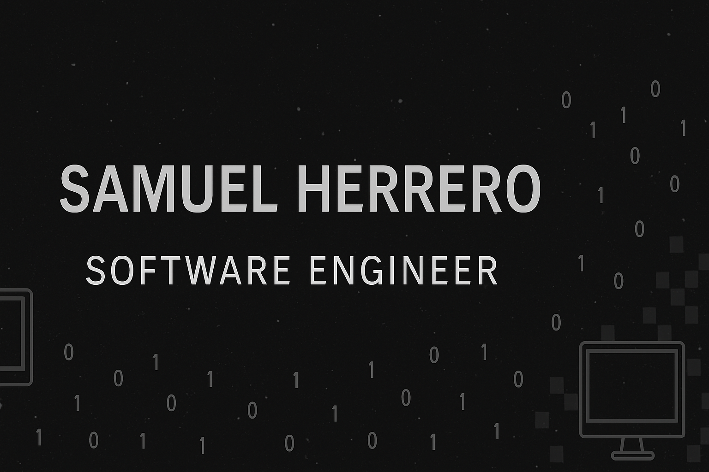
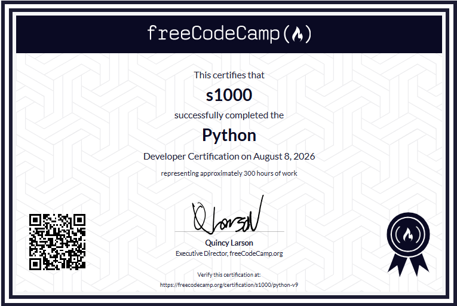

  

<h1 align="center">Samuel Herrero</h1>

  <strong>Software Engineering Student at Universidad Complutense de Madrid</strong>
   
  Learning how software works by building it, versioning it, and understanding the systems around it.

---

## About

I'm a Software Engineering student focused on building a strong technical foundation before specialising too early.

I learn best by turning concepts into practical projects, understanding how they work, and improving them over time. Right now, I'm strengthening my programming fundamentals, becoming more comfortable with Git and GitHub workflows, developing my personal portfolio, and exploring full-stack development, cybersecurity, and artificial intelligence.

I care more about understanding technology properly than collecting technologies I cannot yet use confidently.

## Current focus

- Strengthening programming fundamentals and problem-solving skills.
- Developing my personal portfolio and building meaningful projects.
- Improving my Git and GitHub workflow.
- Exploring full-stack development, cybersecurity, and artificial intelligence.
- Preparing to contribute to open-source projects as my skills grow.

## Technologies

Technologies I'm currently learning and using:

### Languages

### Web

### Development workflow

### Areas I'm exploring

`Full-stack development` · `Cybersecurity` · `Artificial Intelligence`

## Selected work

### Personal portfolio

**In development**

I'm designing and developing my personal portfolio as a place to present future projects, document what I learn, and improve how I communicate technical work.

More selected projects will appear here as they become ready to share.

<!--
PROJECT TEMPLATE

Copy this block below "Selected work" whenever a project is ready.

### Project Name

One concise sentence explaining what the project does and why you built it.

`Technology` · `Technology` · `Technology`

[Repository](REPOSITORY_URL) · [Live demo](DEMO_URL)

Do not include "Live demo" when the project does not have one.
-->

## Certification

  

  <strong>Python Developer Certification</strong>
   
  freeCodeCamp · August 2026 · approximately 300 hours of coursework

## Connect

  <a href="https://github.com/samuher">GitHub</a>
  &nbsp;·&nbsp;
  <a href="https://www.linkedin.com/in/samuel-herrero-213941360/">LinkedIn</a>
  &nbsp;·&nbsp;
  <a href="https://www.youtube.com/channel/samu-y6c">YouTube</a>

